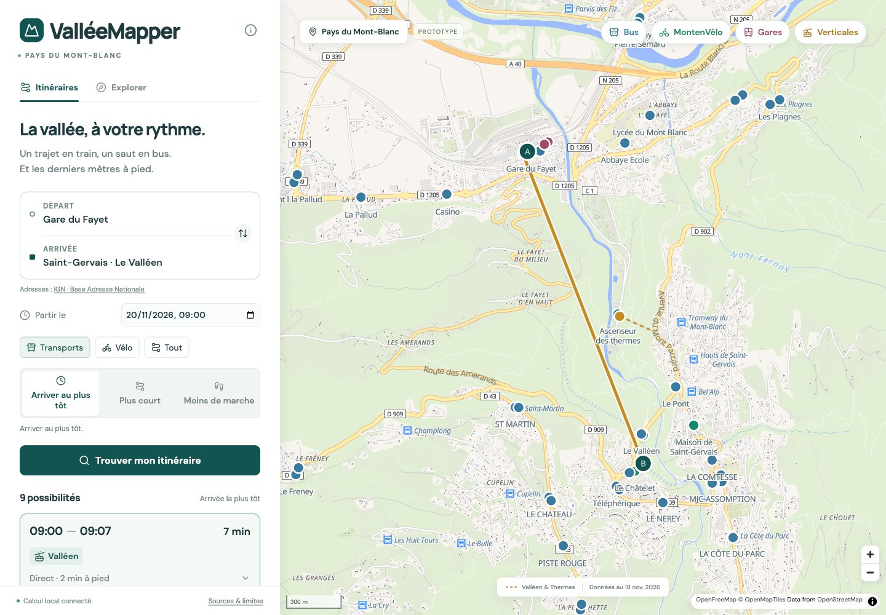

# ValléeMapper · Pays du Mont-Blanc



A working local prototype of a valley journey planner: React/TypeScript, MapLibre and native **MOTIS 2.11.4**. No Java. The UI is in French.

```sh
cd ~/Projects/mont-blanc-mobilite
npm run dev
```

Open **http://127.0.0.1:5173**. The initial dataset and routing graph have already been prepared on this Mac. The development command starts the native router on port 8080, the API on 8787 and Vite on 5173. Ctrl-C stops all three. Ports must be free; `MOTIS_URL` can point the API at an existing MOTIS instance.

Try **Gare de Chedde → Gare de Sallanches** at 09:00 on 19 November 2026, or the **Du train au Valléen** suggestion. Select a result to display its legs and geometry. Choose **Arriver au plus tôt**, **Plus court** (shortest door-to-door journey time, even if departing or arriving later), or **Moins de marche**. The API also tries five-minute walking limits at each end independently and at both ends together. It gives these optional searches up to 350 ms after the main results are ready. Sorting switches immediately among the returned options. Switch to **Explorer** to enable mobility layers and select map points. On mobile, use **Voir la carte** to switch views.

## What works

- Real date-dependent bus and train journey search, walking access, personal-bike routes and address/stop autocomplete. Street and numbered-address searches use the official IGN/BAN geocoder; stops and places use the local MOTIS index. Address-looking queries are sent to IGN, not stored by this application. The results come from the locally running router, not fixtures or a third-party public demo instance.
- Cars Région Y81–Y86 and 274, local SNCF trips, Chamonix and current Saint-Gervais Facilibus. GTFS-RT updates are configured for matching SNCF, Chamonix and Facilibus feeds. A leg is labelled live only if MOTIS reports actual realtime evidence.
- Selectable layers for **515 public bus stops and 21 rail stations**, generated from the imported GTFS feeds. Bus stops, MontenVélo, train stations and vertical links are enabled by default; other layers remain optional. Points can be used as an origin or destination.
- A map of **23 MontenVélo stations, five Citiz stations, 92 Rézo Pouce stops**, plus 392 Montenbus stops, 131 resort shuttle stops and the two vertical links. Bike availability refreshes from GBFS every minute, with a stale/unavailable state. Citiz availability is intentionally not inferred from its inconsistent feed.
- Valléen and thermal lift connections are included using a custom, explicitly estimated GTFS model. Published ride durations and opening hours are used; a one-minute frequency is a modelling assumption, not an operator timetable. Known closures are excluded, including the thermal lift's first Monday of each month. The model expires after 120 days or 31 March 2027, whichever is earlier.
- Published fare hints per network, source links and clear booking handoffs. These are not total journey quotes.

**Tout** is the default mode. **Type de vélo** switches between personal cycling and MontenVélo. Shared-bike routes use current availability and end at a MontenVélo station. Check the operator app for bikes and return space at departure. Citiz round trips, hitchhiking and on-demand Montenbus are not treated as scheduled one-way services. Seasonal resort stop locations remain available for exploration, but expired summer feeds are not routed.

## Prepare or refresh data

For a fresh checkout, use Node 22.12+ and Python 3.11+ on macOS Apple Silicon or Linux x86_64:

```sh
npm ci
npm run setup
npm run dev
```

Stop the app before rebuilding the graph. `npm run data:refresh` downloads fresh **GTFS and OSM inputs**, cleans the map extract, rebuilds the lift model and imports the graph. It does not research new fares, lift opening rules, shared-mobility locations or seasonal shuttle calendars. Those observations remain dated **18 November 2026** in `docs/research/data/` and must be updated explicitly.

The setup script downloads the official executable and verifies its SHA256. It creates a project-local Python venv for `osmium==4.3.0`, so there is no system Python package installation. The OSM source is the roughly 91 MB Haute-Savoie extract from [OpenStreetMap France](https://download.openstreetmap.fr/extracts/europe/france/rhone_alpes/). It is cropped with complete local ways to `[6.48,45.70,7.05,46.02]`, omitting invalid/empty ways; the initial cleanup removed 44. This avoids a native geocoder import failure. Selected GTFS trips keep their original identifiers, full stop sequences, calendars, shapes and transfers. This lets the matching realtime feeds continue to work.

Raw inputs, checksums, cleaned-map report, native executable and imported graph live in ignored `var/`. `python3 scripts/build_transit_locations.py` regenerates bus/train map points from existing imported feeds without rebuilding the router; setup also runs it automatically. Public map data lives in `public/data/valley.json`. Reusing the graph on another machine/architecture is not assumed; run setup there.

## Cloudflare

The included architecture is **Worker + static assets → one shared Durable Object → MOTIS Container**. The same request validation and API adapter run locally and in the Worker.

`wrangler.jsonc` uses the native Durable Object Container API and one fixed router ID. The Linux/amd64 Docker image downloads the checksum-pinned executable and imports the graph **inside the image** from prepared inputs. Graph files therefore survive instance replacement as image contents; no R2 bucket or secrets are needed for this first prototype. Refreshing the feeds requires rebuilding the image. A versioned R2 artifact and scheduled import job would be the next step for routine updates.

### Deploy with GitHub Actions

Pushes to `main` and pull requests run the tests, download the routing inputs, build the site, and start a Linux MOTIS image to check it. The GitHub runner provides Docker. For the first deploy, set up a Cloudflare account with Workers Paid and an active `workers.dev` subdomain. Add two [repository Actions secrets](https://github.com/mathieudutour/valleemapper/settings/secrets/actions):

- `CLOUDFLARE_ACCOUNT_ID` is the target account ID.
- `CLOUDFLARE_API_TOKEN` is an [account API token](https://developers.cloudflare.com/fundamentals/api/get-started/create-token/) created under **Manage Account → API Tokens**. Use **Workers Admin** at the Workers product scope for the first deploy and grant write access to **Containers**. Scope the token to the account hosting ValléeMapper. Once the Worker exists, the Workers permission can be narrowed to **Editor** on `mont-blanc-mobilite`. See [Cloudflare’s Workers roles](https://developers.cloudflare.com/workers/authorization/workers/) and [Containers permissions](https://developers.cloudflare.com/fundamentals/api/reference/permissions/).

In [Actions → Build and deploy](https://github.com/mathieudutour/valleemapper/actions/workflows/build-deploy.yml), choose **Run workflow** on `main`. Wrangler builds and pushes the image and publishes the Worker. The final step waits for the deployed router to report ready and prints the app URL. The first deployment can take a few minutes.

To publish fresh static timetables, run the workflow again. The new image takes effect when the container next starts. The container uses `standard-2`, connects to the live feeds and sleeps after ten minutes of inactivity.

### Deploy from this Mac

For a local deployment, start Docker Desktop and run the commands below. On a fresh checkout, run setup first.

```sh
npx wrangler login
npm run build && npx wrangler deploy
```

`npm run cloudflare:check` validates the Worker configuration and assets in a dry run. The Linux image was built successfully on this Mac, and the train and Valléen smoke tests passed through the local Worker and container.

## Validation

```sh
npm run build       # frontend + local API + Worker types, then production bundle
npm test            # address, routing and preference regressions
npm run smoke       # requires npm run dev in another terminal
npm run cloudflare:check
```

Verified on 18 November 2026: native import, real rail/bus results, Valléen connectivity and leg geometry, invalid-coordinate rejection, polyline precision, address geocoding and 23 live bike statuses. Browser checks cover desktop and a 390px mobile viewport, route selection, map layers, a bike-station detail card and its live status. See `docs/validation.md`.

## Limits and sources

This is an exploration prototype. It does not validate wheelchair access, gradients, bike carriage for every line, all disruption alerts, minimum transfer feasibility or fare entitlements. Some transit geometry comes from stop-to-stop interpolation when operators omit shapes. Public APIs may change or become unavailable. The lift model must be checked against closures and current opening rules before real travel.

The dated research and machine-readable provenance are in [docs/research](docs/research/):

- [Data inventory](docs/research/passy-transport-data.md)
- [Resort shuttles, vertical links and fares](docs/research/shuttles-lifts-fares.md)
- [Stack and hosting research](docs/research/transport-stack.md)
- [Pinned MOTIS API contract](docs/research/motis-api.md)
- [Source endpoints and licences](docs/research/data/sources.json)

OpenStreetMap data © contributors, ODbL. Tiles via OpenFreeMap/OpenMapTiles with visible attribution. GTFS/GBFS and other datasets retain their own terms as recorded in the inventory. Some resort/Montenbus/vertical-link API reuse licences are unverified: public access alone is not a redistribution licence. Review those entries before publishing the prototype or its bundled data.
